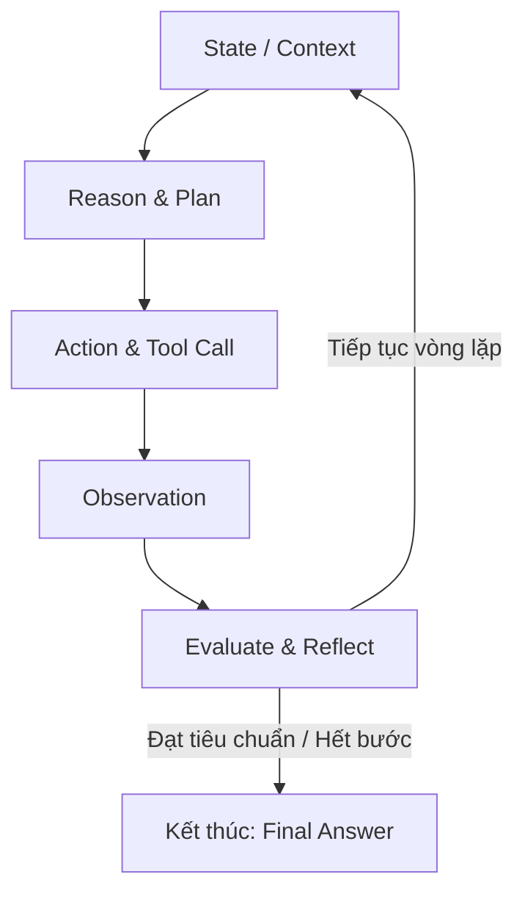

# Loop Engineering in AI Agents: Kiến trúc tối ưu vòng lặp thực thi & Nguồn tài liệu

---

## 1. Tổng quan về Loop Engineering

**Loop Engineering** là kỹ thuật thiết kế, kiểm soát và tối ưu hóa **vòng lặp phản hồi (feedback loop)** trong hệ thống AI Agent tự chủ (*Autonomous Agents*).

Nếu **Prompt Engineering** tập trung vào một lượt gọi mô hình đơn lẻ (*single-turn inference*) để tinh chỉnh câu trả lời tức thời, thì **Loop Engineering** chuyển trọng tâm sang **kiến trúc luồng trạng thái đa lượt (*multi-turn system architecture*)**. Kỹ thuật này giúp agent duy trì khả năng tự hành qua nhiều bước mà không gặp phải các vấn đề:
* Tràn ngữ cảnh (*context bloat / context exhaustion*).
* Lạc hướng khỏi mục tiêu ban đầu (*goal drift*).
* Kẹt trong các bẫy lặp vô tận (*infinite loop traps*).
* Bùng nổ chi phí token và độ trễ (*cost & latency explosion*).

---

## 2. Mô hình vòng lặp cơ bản

Vòng lặp tiêu chuẩn của một agent thường dựa trên mô hình **ReAct (Reason + Act)** hoặc **OODA (Observe, Orient, Decide, Act)**:

---

## 3. Các trụ cột kỹ thuật cốt lõi

### a. Kiểm soát trạng thái & Rút gọn ngữ cảnh (State & Context Compaction)
* **Dynamic Summarization:** Tóm tắt các bước trung gian cũ thành một bản ghi cô đọng về tiến độ và bài học rút ra, tránh việc đưa toàn bộ lịch sử thô vào lượt suy luận mới.
* **Scratchpad Pruning:** Cắt tỉa các đoạn log lỗi, stack trace hoặc output dài của công cụ ngay sau khi lỗi đã được sửa thành công.

### b. Thiết kế điều kiện dừng (Termination & Guardrails)
* **Hard & Soft Caps:** Thiết lập giới hạn số bước lặp tối đa. Khi chạm *soft cap* (ví dụ: bước 12/15), ép agent chuyển sang chế độ tổng hợp (*wrap-up mode*) thay vì mở rộng tìm kiếm.
* **Cost & Token Budgeting:** Đặt trần ngân sách token hoặc chi phí API cho từng phiên làm việc.
* **Deterministic Verification:** Ưu tiên dùng tín hiệu kiểm chứng từ môi trường thực (exit code của compiler, unit test pass 100%, linter sạch) làm điều kiện dừng thay vì chỉ phụ thuộc vào việc mô hình tự đánh giá hoàn thành.

### c. Phát hiện và thoát bẫy lặp (Loop Detection & Convergence)
* **Action State Hashing:** Lưu trữ hash của lệnh và tham số gần nhất. Nếu agent gọi cùng một thao tác liên tục mà không sinh ra trạng thái mới, hệ thống sẽ chèn *system intervention prompt* cảnh báo đổi chiến lược.
* **Temperature & Fallback Scaling:** Nâng nhẹ `temperature` hoặc chuyển sang mô hình suy luận mạnh hơn khi phát hiện tốc độ hội tụ của vòng lặp bị đình trệ.

### d. Tự đánh giá và phản hồi môi trường (Reflection & Grounding)
* **Critic / Judge Step:** Tách riêng một bước kiểm định (có thể dùng một agent/model khác) để phản biện kết quả trước khi chốt luồng.
* **Grounded Feedback:** Phản hồi sửa sai phải xuất phát từ kết quả thực tế của môi trường (terminal output, schema validation errors) để triệt tiêu ảo giác (*hallucination*).

### e. Phân rã vòng lặp đa tầng (Hierarchical & Sub-loops)
* **Outer Loop (Planner/Manager):** Theo dõi tiến độ mục tiêu vĩ mô, lập roadmap và phân phối task.
* **Inner Loop (Worker/Executor):** Vòng lặp vi mô, tập trung giải quyết triệt để một task cụ thể (Code $\rightarrow$ Test $\rightarrow$ Fix) rồi trả quyền điều khiển về cho Outer Loop.

---

## 4. So sánh: Prompt Engineering vs. Loop Engineering

| Tiêu chí | Prompt Engineering | Loop Engineering |
| :--- | :--- | :--- |
| **Phạm vi** | 1 lượt gọi LLM đơn lẻ (*Single inference*) | Toàn bộ chu trình thực thi (*Multi-step pipeline*) |
| **Mục tiêu chính** | LLM hiểu đúng chỉ dẫn và định dạng dữ liệu | Hệ thống tự hội tụ về kết quả đúng mà không bị kẹt |
| **Công cụ cốt lõi** | Few-shot, System prompts, Chain-of-Thought, XML/JSON tags | State machines, Memory management, Circuit breakers, Tool routing |
| **Trọng tâm kỹ năng** | Ngôn ngữ học, thấu hiểu hành vi mô hình | Kiến trúc hệ thống phần mềm, xử lý ngoại lệ (*Error handling*) |

---

## 5. Tài liệu & Nguồn tham khảo uy tín

### A. Nghiên cứu học thuật (Research Papers)
* **[ReAct: Synergizing Reasoning and Acting in Language Models](https://arxiv.org/abs/2210.03629)**  
  *Tác giả:* Shunyu Yao et al. (Google Research & Princeton University)  
  *Mô tả:* Nghiên cứu nền tảng kết hợp suy luận phân tích và thực thi hành động trong các mô hình ngôn ngữ lớn.
* **[Reflexion: Language Agents with Verbal Reinforcement Learning](https://arxiv.org/abs/2303.11366)**  
  *Tác giả:* Noah Shinn et al. (Northeastern University & MIT)  
  *Mô tả:* Cơ chế tự phản hồi bằng ngôn ngữ tự nhiên để học hỏi từ lỗi sai qua từng vòng lặp mà không cần fine-tune trọng số.
* **[Plan-and-Solve Prompting: Improving Zero-Shot Chain-of-Thought Reasoning](https://arxiv.org/abs/2305.04091)**  
  *Tác giả:* Lei Wang et al.  
  *Mô tả:* Cơ sở lý thuyết cho việc tách rời vòng lặp Planner (lập kế hoạch) và Solver (thực thi kế hoạch).

### B. Hướng dẫn thiết kế hệ thống từ AI Labs
* **[Building Effective Agents (Anthropic Research)](https://www.anthropic.com/research/building-effective-agents)**  
  *Mô tả:* Phân tích chi tiết các mẫu thiết kế thực tế (Chains, Evaluator-Optimizer loops, Routing) và lời khuyên về việc kiểm soát độ phức tạp của vòng lặp.
* **[LLM Powered Autonomous Agents (Lilian Weng)](https://lilianweng.github.io/posts/2023-06-23-agent/)**  
  *Mô tả:* Bài tổng quan toàn diện về hệ thống agent gồm Planning, Memory (ngắn hạn/dài hạn) và Tool Use.

### C. Triển khai & Frameworks thực tế
* **[LangGraph Documentation (LangChain)](https://langchain-ai.github.io/langgraph/)**  
  *Mô tả:* Nền tảng điều phối agent dựa trên đồ thị trạng thái có chu trình (*Cyclic State Machines*), hỗ trợ checkpointing và Human-in-the-loop.
* **[Microsoft AutoGen](https://microsoft.github.io/autogen/)**  
  *Mô tả:* Framework hội thoại đa agent với các cơ chế thiết lập điều kiện dừng (*termination condition*) và chuyển giao tác vụ.
* **[SWE-agent (Princeton NLP)](https://swe-agent.com/)**  
  *Mô tả:* Thiết kế giao diện máy tính - agent (*Agent-Computer Interface*) chuyên biệt cho lập trình tự động với các bộ lọc context và cơ chế chống lặp.